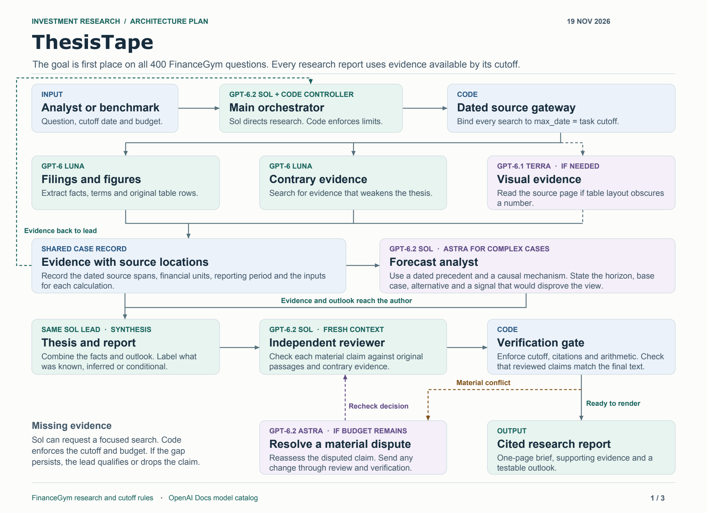

# ThesisTape

ThesisTape is a multi-agent research project for testing investment theses using only information that was public by a chosen date. An analyst will be able to enter a question, a cutoff date and a budget, then trace each material claim in the resulting memo back to its source.

The first implementation milestone is an offline Disney/Hulu case. It uses Disney’s November 2023 Form 8-K to distinguish the payment Disney expected from the price that was still open to appraisal. The evaluation plan compares the multi-agent workflow with a single analyst agent before submitting reports to FinanceGym.

[Build plan and validation milestones](BUILD_PLAN.md) · [Architecture and model costs (PDF)](ThesisTape-Architecture.pdf)



## Reproduce the Disney/Hulu case

From the repository root, run these commands with Python 3.9 or later.

```sh
python3 scripts/disney_hulu_case.py verify
case_workspace="$(mktemp -d)"
python3 scripts/disney_hulu_case.py import --output-dir "$case_workspace/disney-hulu"
python3 scripts/disney_hulu_case.py verify --case-dir "$case_workspace/disney-hulu"
python3 -B -m unittest discover -s tests -v
```

Give the research agent the two files in the case’s `agent/` directory. The evaluator uses the separate `evaluator/` directory to grade the answer and check the dated sources. Import and verification run offline.

The importer reads the saved filings and indexes from the repository by default. Pass `--filings-dir DIR` to read the same four HTML files by their saved names from a single directory. The manifests and scoring sheet come from the versioned case. Reusing a destination with identical files succeeds without rewriting it.

The stored Form 8-K documents are the original HTML payloads inside EDGAR’s complete submissions. The direct HTML responses included an archive script. The saved payloads match EDGAR’s listed sizes and the rest of each direct response byte for byte. The evaluator manifest links to both complete submissions and the index snapshots.

## Run the single-Sol baseline

The baseline uses the verified Disney archive and sends only the dated passages to GPT-6.2 Sol. It validates the structured response, links each memo section to the cited filing text, and recomputes the disclosed payment from the sourced inputs with decimal arithmetic. The agent receives the question, cutoff and admitted passages. The scoring sheet and later filing are used from the evaluator side.

Set up the baseline dependencies with Python 3.12.

```sh
python3.12 -m venv .venv
.venv/bin/python -m pip install -r requirements-baseline.txt
.venv/bin/python -B -m unittest discover -s tests -v
```

With `OPENAI_API_KEY` in the ignored project `.env.local` or shell environment, run the CLI using a fresh output path.

```sh
.venv/bin/python -B -m scripts.sol_baseline run --budget-usd 0.05 --output-dir runs/disney-sol
.venv/bin/python -B -m scripts.sol_baseline replay --run-dir runs/disney-sol > runs/disney-sol/replayed.md
cmp runs/disney-sol/memo.md runs/disney-sol/replayed.md
```

`memo.md` is the analyst deliverable. `run.json` records the cutoff-bound retrieval, source hash, prompt version, request hash, provider IDs, latency, token counts, arithmetic and cost estimate. The CLI counts input tokens and reserves enough for the output limit before sending one generation request. Replay rechecks those inputs and renders the saved response without contacting OpenAI. Costs use the published Standard rates and remain estimates until reconciled with billing. [OpenAI GPT-6.2 Sol pricing](https://developers.openai.com/api/docs/models/gpt-6.2-sol)
