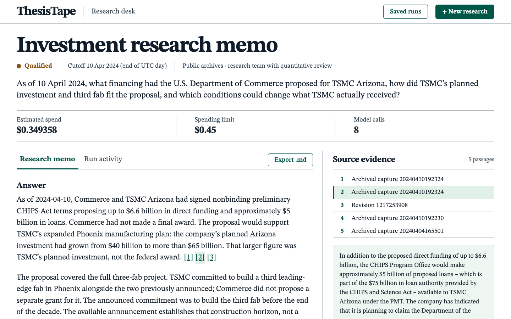

# ThesisTape

**Point-in-time financial research with citations you can open.**

Give ThesisTape a financial question, an information cutoff and a spending limit. It searches dated source editions and returns a memo with cited evidence, an outlook, and a record of what the research cost.

[Review the FinanceGym submission](#financegym-submission) · [Read a submitted memo](docs/financegym-examples/intel-altera.md) · [Run the analyst desk](#run-the-analyst-desk) · [Replay all 400 reports](#verify-the-submission)

## FinanceGym submission

ThesisTape submitted reports for all **400 questions** on **20 November 2026**. FinanceGym’s maintainers assign the official score and rank. [FinanceGym leaderboard](https://financegym.github.io/#leaderboard)

| Recorded result | Value |
| --- | ---: |
| Reports reproduced from the archived evidence | **400 / 400** |
| Reports marked complete by ThesisTape | 127 |
| Reports identifying gaps in the dated evidence | 273 |
| Estimated model cost across benchmark attempts | USD 90.38 |
| Average model cost per question | USD 0.2259 |

The release counts come from ThesisTape’s own checks. The registered primary and recovery routes released 361 reports. Procedures documented during the run supplied 39 more. The audit includes all attempts and their costs. [Full results and limitations](evaluations/financegym/evaluation.md) · [Methodology PDF](evaluations/financegym/methodology.pdf) · [Download the submitted JSONL](https://raw.githubusercontent.com/KarthikRamesh9149/ThesisTape/6c04ea66823dbb2f94551c081cf69b936156d820/evaluations/financegym/results/answers.jsonl)

### Read two submitted reports

| Report | Cutoff | What to look for |
| --- | --- | --- |
| [Intel’s Altera divestiture](docs/financegym-examples/intel-altera.md) | 20 August 2025 | How the memo weighs the expected liquidity gain against the investment and customer commitments needed to compete in AI accelerators. |
| [Canadian domestic demand](docs/financegym-examples/canadian-demand.md) | 17 June 2025 | How a qualified memo reasons from available evidence and identifies figures it could not substantiate by the cutoff. |

Both Markdown files reproduce the submitted report text byte for byte. [Sample task IDs and hashes](docs/financegym-examples/README.md)

## Run the analyst desk

The desk opens with a saved memo on TSMC’s Arizona financing. Select a numbered citation to read the source passage alongside the memo. Use **Open original** to check the archived page and **Export .md** to download the report. The saved demo runs with zero model calls. [TSMC memo and evaluation](evaluations/open_research/tsmc/evaluation.md)

<p align="center">
  
</p>

```sh
git clone https://github.com/KarthikRamesh9149/ThesisTape.git
cd ThesisTape
python3.12 -m venv .venv
.venv/bin/python -m pip install -r requirements-baseline.txt -r requirements-retrieval.txt
.venv/bin/python -B -m scripts.analyst_desk --port 8765
```

Open the desk at [127.0.0.1:8765](http://127.0.0.1:8765/). To start a live investigation, set `OPENAI_API_KEY` locally and choose **New research**. The [research guide](docs/research-guide.md#ask-a-historical-finance-question) explains the available research methods, spending limits and pause and resume controls.

## How ThesisTape works

1. **Bind the cutoff to retrieval.** Each search sends the question’s cutoff as `max_date`. The gateway checks the availability of an archived capture, revision or filing before returning it to the researcher.
2. **Research and review.** The run can use a single analyst or a team with separate evidence, calculation and review roles. The team checks material claims against source passages and can flag unresolved gaps in the memo.
3. **Save the evidence.** Reports retain citations, dated source references and measured model usage. Portable records let a reviewer replay the result offline.

[Architecture and model costs](ThesisTape-Architecture.pdf) · [Research workflow diagram](ThesisTape-Architecture.png) · [How the FinanceGym candidate was selected](evaluations/financegym/selection.md)

## Verify the submission

From the repository root, install the dependencies as shown in the quickstart, then fetch the pinned public questions and run the verifier.

```sh
mkdir -p runs
curl -fsSL 'https://raw.githubusercontent.com/google-research/google-research/c878a53ec1764bcb91a6178dc5c315202a3b5fa2/finance_harness/FinanceGym/data/benchmark_400_public.jsonl' \
  -o runs/benchmark_400_public.jsonl
.venv/bin/python -B -m evaluations.financegym.evidence verify runs/benchmark_400_public.jsonl
```

The verifier checks the dataset fingerprint, replays the 400 submitted reports and reconciles sources, elapsed time and cost from the saved evidence. After the one-time download, the replay runs offline without an API key. GitHub Actions runs the FinanceGym tests and the same report replay. [GitHub verification runs](https://github.com/KarthikRamesh9149/ThesisTape/actions/workflows/verify.yml) · [Artifact manifest](evaluations/financegym/results/manifest.json) · [Search all 400 reports offline](evaluations/financegym/README.md#browse-the-reports-offline)

## Run the research team

The research guide covers [live team runs and offline replay](docs/research-guide.md#run-the-research-team), [the single-Sol baseline](docs/research-guide.md#run-the-single-sol-baseline), and [the dated retrieval archive](docs/research-guide.md#search-the-point-in-time-archive). The [build plan](BUILD_PLAN.md) records the development milestones and evaluations.

### Run the single-Sol baseline

Use the [baseline replay commands](docs/research-guide.md#run-the-single-sol-baseline) to reproduce the saved Disney/Hulu memo without an API key.
